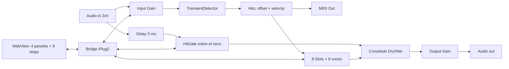
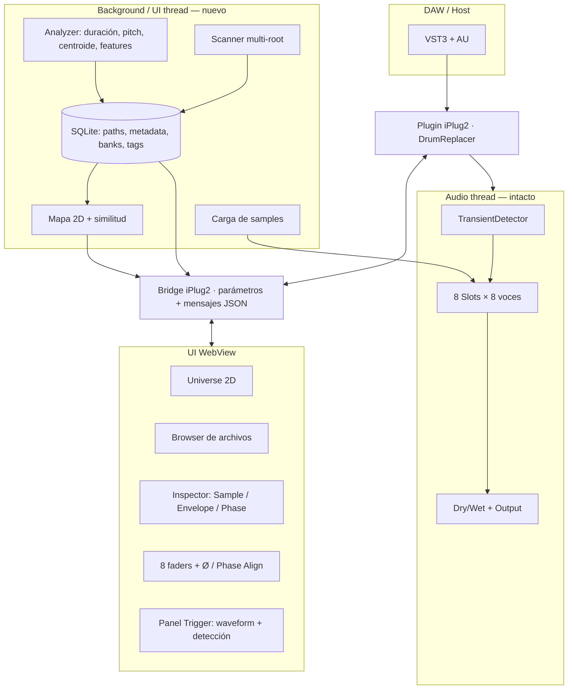

# Fase 0 — Arquitectura y plan de integración

Companion del informe `01_informe_auditoria.md`. Fecha: 20/11/2026.

## 1. Arquitectura actual (verificada)

Cadena confirmada en `DrumReplacer.cpp:186-297`. El detector reporta hits 5 ms antes de que aparezca el pico; esa latencia se declara al host y se compensa en el seco.

## 2. Arquitectura objetivo (propuesta)

**Reglas de oro que se mantienen:**

- El audio thread nunca lee disco, decodifica, calcula FFT ni espera a la UI.
- Los samples se cargan y preparan fuera del audio thread y se entregan con el swap atómico existente.
- Los cambios de polaridad/offset se preparan fuera del callback y se aplican sin clicks.
- Los medidores y eventos se mandan a la UI a ~20 ms (`OnIdle`), nunca por sample.

## 3. Plan de integración por fases

### Fase 0 — Auditoría y cimentación *(esta entrega)*

| Tarea | Estado |
| --- | --- |
| Leer brief y specs del original | ✅ |
| Auditar motor, parámetros, estado, UI y build | ✅ |
| Correr tests DSP | ✅ 3/3 |
| Analizar XO.vst (referencia visual/funcional) | ✅ |
| Verificar entorno de build | ⚠️ bloqueado: faltan Xcode/cmake/node/SDKs |
| Aprobar decisiones abiertas | ✅ aprobadas el 20/11/2026 (ver §4) |

**Entregable:** este informe + diagrama + plan. No se modifica el motor.

### Fase 1 — Library / Browser

- Diseñar esquema SQLite: `roots`, `banks`, `folders`, `samples`, `features`, `tags`, `favorites`, `history`.
- Scanner en background con escaneo incremental (mtime + hash), multi-root en discos distintos.
- Analizador offline: duración, pitch fundamental, centroide espectral, rolloff, flatness, RMS/peak, ataque/decaimiento, mono/estéreo, sample rate.
- Browser en árbol + búsqueda global/por banco + filtros + favoritos.
- Audition sin cargar en slot.
- Missing files y relocalización.
- **Criterios:** aceptación 1, 2, 3, 15 y 16 del brief.

### Fase 2 — Universe

- Proyección 2D: X = duración (log), Y = frecuencia/centroide (log).
- Zoom/pan, selección, hover con metadata, highlights.
- Filtros que no reescanean: operan sobre el índice en memoria.
- Similitud tímbrica con features (no basada solo en X/Y).
- **Criterios:** aceptación 4 y 16.

### Fase 3 — Sample Editor + Phase / Align

- Waveform con zoom, start/end, fade in/out, audición de región, “volver al original”.
- Envelope: agregar **Decay** para tener **ADSR real** (el motor solo tiene A/S/R).
- **Fade in / fade out** con curva visible y audición de la región recortada.
- Start/End, trim y “volver al original”. Sin time-stretch.
- Tune (st + cents), pan, gain, reverse, tone/cut, velocity sensitivity.
- Panel **PHASE / ALIGN** contiguo al ADSR pero funcionalmente separado:
  - Polaridad normal/invertida (Ø = 180°).
  - **Phase shift** independiente: 90° / 260° por slot (all-pass / Hilbert).
  - Offset temporal en samples/ms.
  - Audition/compare y marcadores de alineación.
- **Criterios:** aceptación 5, 6, 13 y 16.

### Fase 4 — Ocho slots y mixer

- Drag & drop desde Universe y Browser a cualquier slot.
- Reemplazar solo el slot destino; feedback visual antes de reemplazar.
- Extender el `Slot` actual con: Decay, Start/End, fades, Phase Shift y Phase/Align.
- Fader por slot con Level, Pan/Tune, Mute/Solo, Ø (180°), Phase Shift (90°/260°) y Align compacto.
- Un solo estado compartido: fader e inspector controlan el mismo parámetro (sin valores duplicados).
- Flip All Polarity / Restore.
- Crossfade o aplicación en límite de bloque para cambios de polaridad/offset.
- **Criterios:** aceptación 7, 8, 9, 10, 11, 12, 13, 14.

### Fase 5 — Pulido y release

- Presets `.drp`, dirty flag, missing files, automatización expuesta.
- Formatos AU + VST3 (AAX descartado por decisión del usuario).
- Firma/notarización, validación en hosts, pruebas de rendimiento con bibliotecas grandes.
- **Criterios:** aceptación 14, 15, 16.

## 4. Decisiones aprobadas (20/11/2026)

| # | Decisión | Resolución |
| --- | --- | --- |
| 1 | Framework | **iPlug2**. Se conserva el motor existente; no se migra a JUCE |
| 2 | Formatos | **AU + VST3**. **AAX queda fuera** |
| 3 | UI | **React + TypeScript** sobre el bridge WebView de iPlug2 |
| 4 | Envelope y edición | **ADSR real** (agregar Decay) + **fade in / fade out** + **start/end y trim**. Sin time-stretch |
| 5 | Fase | **Ø sigue siendo polaridad 180°**; se agrega un **phase shift separado** con valores 90° / 260° por slot |
| 6 | Código base | **Importado a `engine/`** (`engine/DrumReplacer` + `engine/_iPlug2`) |
| 7 | Reverse engineering de XO | **Todo el funcionamiento**, pero solo a nivel funcional/UX: sin copiar código, assets ni diseño propietario |
| 8 | Preset browser tipo XO | **Fuera de alcance**: no se implementa el browser de presets de XO |
| 9 | BPM sync / tempo | **Fuera de alcance**: no hay sync a tempo ni BPM |
| 10 | Search & Filter | **Dentro de alcance**: búsqueda por texto, categorías, favoritos, rangos (Main Freq, Length, Druminess), fecha y carpetas, con contador en vivo |

### Implicación técnica del phase shift

La inversión de polaridad (180°) es solo un cambio de signo. Los shifts de **90° y 260°** requieren un desplazamiento de fase real: se implementará con un **all-pass filter / transformada de Hilbert por slot**, no con un retardo ni con `-1`. El rango y la estabilidad se validarán con tests antes de exponerlo al host.

El “offset temporal” del brief se mantiene como control independiente (alineación en samples/ms), separado del phase shift.

## 5. Bloqueos de entorno a resolver antes de la Fase 1

1. Instalar **Xcode completo** (App Store) y correr `sudo xcode-select -s /Applications/Xcode.app/Contents/Developer`.
2. Instalar **CMake** y **Node.js** (para React).
3. Descargar el SDK de VST3 con `engine/_iPlug2/Scripts/download-iplug-sdks.sh` (AAX no se necesita).
4. Recuperar o crear `scripts/build-mac.sh`, que hoy falta y es necesario para firmar los recursos WebView del bundle.
5. Hacer el primer build baseline del VST3 actual y verificarlo en Ableton.

## 6. Nota sobre el plugin de referencia XO

XO 1.8.10 es **JUCE 8.0.7 + WebKit**, VST2, universal arm64/x86_64. Confirma que la combinación C++ + UI web es viable en este dominio, pero **no se copiará nada de su implementación**. Se usa solo como guía de interacción y organización visual, según el brief.
